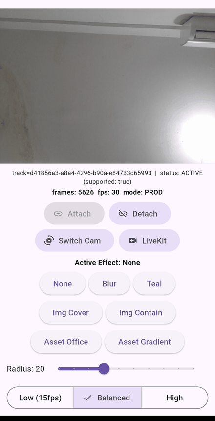

# mi_virtual_background_kit

[](https://github.com/Azmi010/mi_virtual_background_kit/actions/workflows/ci.yml)
[](https://pub.dev/packages/mi_virtual_background_kit)

Real-time virtual background — blur, image, solid color — for the **local
camera track** of Flutter apps built on
[`flutter_webrtc`](https://pub.dev/packages/flutter_webrtc). Segmentation runs
on-device (MediaPipe), compositing runs on the GPU, frames never enter Dart.
No network, no telemetry, MIT.



## The problem

Flutter video-call apps struggle to find a maintained, vendor-neutral virtual
background package for Android and iOS. Vendor SDKs are closed or paid; custom
native work (person segmentation, frame threading, compositing) is costly to
build and maintain. This package solves exactly one problem: replace the
background of the local camera track, behind a small Dart API.

## Platform support

| Platform | Status |
|----------|--------|
| Android  | ✅ minSdk 24, OpenGL ES 2.0+ |
| iOS      | ✅ iOS 15.0+, Metal |
| Web      | ❌ not supported |
| Desktop  | ❌ not supported |

Requires `flutter_webrtc: ^1.6.2` (tested through `1.6.3`) and Dart 3.6 /
Flutter 3.27 or newer.

## Install

```yaml
dependencies:
  mi_virtual_background_kit: ^0.2.0
  # Add only if you use LiveKit:
  mi_virtual_background_kit_livekit: ^0.2.0
```

### Native setup

**Android** — nothing to do if `flutter_webrtc` works in your app: this
package needs no extra permissions or Gradle entries (minSdk 24 is declared by
the plugin and merged into your app; Flutter's own default already meets it on
current SDKs).

**iOS** — your app's `Info.plist` must contain usage descriptions (the app
crashes on `getUserMedia` without them):

```xml
<key>NSCameraUsageDescription</key>
<string>Camera is used for video calls.</string>
<key>NSMicrophoneUsageDescription</key>
<string>Microphone is used for video calls.</string>
```

Camera permission itself is requested automatically by `flutter_webrtc` on
first capture.

## Quick example

```dart
import 'package:flutter_webrtc/flutter_webrtc.dart';
import 'package:mi_virtual_background_kit/mi_virtual_background_kit.dart';

final kit = MiVirtualBackgroundKit();

if (await kit.isSupported()) {
  final stream = await navigator.mediaDevices.getUserMedia({
    'audio': false,
    'video': {'facingMode': 'user'},
  });
  final track = stream.getVideoTracks().first;
  await kit.attach(track, quality: BackgroundQuality.balanced);

  // Effects switch at runtime — the camera never restarts.
  await kit.setEffect(const BlurEffect(radius: 12));
  await kit.setEffect(ImageEffect.asset('assets/office.jpg'));
  // e.g. bytes your app downloaded from its own backend:
  await kit.setEffect(ImageEffect.bytes(bytes, fit: BackgroundFit.cover));
  await kit.setEffect(const ColorEffect(Color(0xFF0E1114)));
  await kit.setEffect(const NoEffect());

  kit.statusStream.listen((status) { /* idle, initializing, active, error */ });
}

await kit.detach();
await kit.dispose();
```

Full walkthrough, camera switching, and performance tips:
**[doc/integration.md](https://github.com/Azmi010/mi_virtual_background_kit/blob/main/doc/integration.md)**.

## Effects

- `BlurEffect` — background blur with adjustable radius
- `ImageEffect` — background image from asset, file path, or raw bytes;
  `BackgroundFit.cover` or `.contain`
- `ColorEffect` — solid color
- `NoEffect` — full bypass, no per-frame processing

Switch any of them at runtime (`setEffect`), change quality live
(`setQuality`), all without touching the camera track.

## Preview (pre-join lobby)

`VirtualBackgroundPreviewController` opens the camera, attaches the kit, and
`VirtualBackgroundPreview` renders the result. `releaseToCaller()` hands the
still-running track and kit to your call UI without stopping the camera:

```dart
final controller = VirtualBackgroundPreviewController(
  quality: BackgroundQuality.balanced,
);
await controller.start();
await controller.setEffect(ImageEffect.asset('assets/office.jpg'));

// In your widget tree:
VirtualBackgroundPreview(controller: controller, mirror: true);

// When the user joins the call:
final handoff = await controller.releaseToCaller();
// handoff.stream / handoff.track / handoff.kit are now yours to dispose.
await controller.dispose();
```

`controller.switchCamera()` re-attaches and keeps the last effect. `stop()` and
`dispose()` are idempotent. After handoff, `dispose()` does not touch the track.

## LiveKit

For LiveKit apps, prefer the separate adapter package. It depends on the core
plus `livekit_client`, so other apps do not pull those dependencies:

```dart
final vb = LiveKitVirtualBackground(room: room);
await vb.attach(localVideoTrack, quality: BackgroundQuality.balanced);
await vb.setEffect(const BlurEffect(radius: 12));
await vb.detach();
await vb.dispose();
```

Passing `room:` keeps the effect across camera switches, mute/unmute,
unpublish/republish, and track restarts. Remote tracks and screen share are not
supported. See the [integration guide](https://github.com/Azmi010/mi_virtual_background_kit/blob/main/doc/integration.md#livekit)
for the full recipe and a dependency-free manual alternative.

## Status, errors, and performance fallback

- `statusStream` → `ProcessorStatus` (`idle`, `initializing`, `active`,
  `error`).
- Typed errors (`BackgroundException`): `unsupportedPlatform`,
  `modelLoadFailed`, `invalidTrack`, `invalidImage`.
- `fallbackStream` → automatic quality degradation or effect disable when the
  device cannot keep up (FR-12), so you can inform the user instead of
  shipping a frozen video.
- `metricsStream` → local diagnostics about once per second while an effect
  is active: output fps, last segmentation latency, mask age, and processor
  latency (`BackgroundMetrics`). Reporting only runs while you listen; nothing
  ever leaves the device.

A stage-2 fallback disables the effect and moves status to `idle`. Call
`resumeEffect()` when load drops, or enable hysteresis-based auto recovery:

```dart
await kit.attach(
  track,
  quality: const BackgroundQuality(autoRecovery: true),
);
kit.fallbackStream.listen((event) {
  if (event.action == FallbackAction.disabled) showRecoveryHint();
  if (event.action == FallbackAction.recovered) hideRecoveryHint();
});
await kit.resumeEffect(); // manual path; no-op when the effect is still active
```

Auto recovery waits for healthy fps over two windows and latches after a second
failure, so it cannot oscillate. `FallbackAction.recovered` is new in 0.2 —
exhaustive `switch` statements need a `recovered` branch.

## Performance

Measured 10-minute sessions (see [doc/benchmark.md](https://github.com/Azmi010/mi_virtual_background_kit/blob/main/doc/benchmark.md)):

| Device | Class | FPS (blur/image/color/none) |
|--------|-------|------------------------------|
| Samsung SM-A135F (32-bit) | low-end | 28.4 – 30.0 |
| iPhone 15 | high-end | 30.0 |

Conservative defaults (`segmentationWidth: 256`) can be tuned per call with
`BackgroundQuality`; 32-bit devices segment noticeably slower — start with
`BackgroundQuality.low` there.

## Documentation

- [Integration guide (flutter_webrtc + LiveKit)](https://github.com/Azmi010/mi_virtual_background_kit/blob/main/doc/integration.md)
- [FAQ & troubleshooting](https://github.com/Azmi010/mi_virtual_background_kit/blob/main/doc/faq.md)
- [Benchmark results](https://github.com/Azmi010/mi_virtual_background_kit/blob/main/doc/benchmark.md)
- [Test matrix](https://github.com/Azmi010/mi_virtual_background_kit/blob/main/doc/test-matrix.md)
- [Architecture decisions (ADR)](https://github.com/Azmi010/mi_virtual_background_kit/blob/main/doc/adr/0001-core-architecture.md)
- [Example app](https://github.com/Azmi010/mi_virtual_background_kit/blob/main/example)

## Limitations

- Local camera track only — remote participants' video is not processed.
  Shared camera tracks (a second `getUserMedia` on an open camera) are handled
  since 0.2 by redirecting the processor to the wired track.
- Android + iOS only; no web/desktop.
- No noise suppression, beauty filters, or AR effects.
- No image hosting or library: the app supplies background images.
- Performance varies by device; conservative defaults, adaptive fallback,
  honest numbers in the benchmark doc.
- Processor latency (frame delivered to the native processor → composited
  frame returned to WebRTC, from `BackgroundMetrics.processorLatencyMs`):
  Samsung SM-A135F median 0.9 ms, mean 6.0 ms (p95 27.2 ms on frames doing
  mask readback); iPhone 15 median 1.4 ms. This is not a glass-to-glass
  number — camera sensor readout and screen display are not included.

## License

MIT — see [LICENSE](https://github.com/Azmi010/mi_virtual_background_kit/blob/main/LICENSE).
The bundled segmentation model (`selfie_segmenter.tflite`, 250 KB) is
Apache-2.0.
