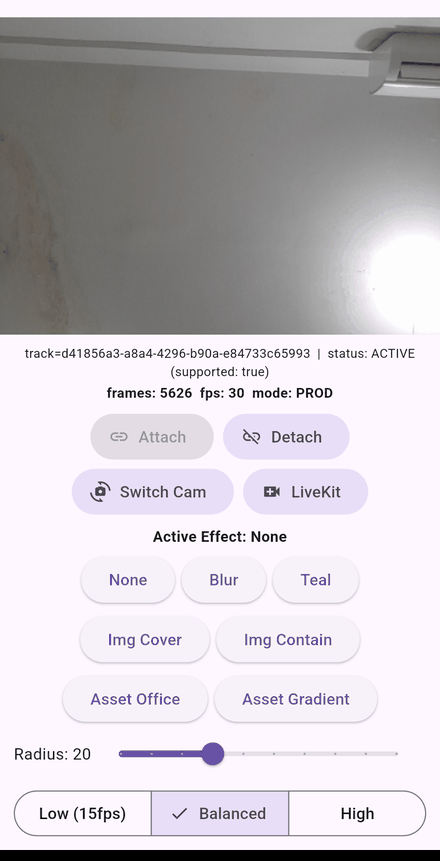

# mi_virtual_background_kit

[](https://github.com/Azmi010/mi_virtual_background_kit/actions/workflows/ci.yml)
[](https://pub.dev/packages/mi_virtual_background_kit)

Real-time virtual background — blur, image, solid color — for the **local
camera track** of Flutter apps built on
[`flutter_webrtc`](https://pub.dev/packages/flutter_webrtc). Segmentation runs
on-device (MediaPipe), compositing runs on the GPU, frames never enter Dart.
No network, no telemetry, MIT.



## The problem

Flutter video-call apps struggle to find a maintained, vendor-neutral virtual
background package for Android and iOS. Vendor SDKs are closed or paid; custom
native work (person segmentation, frame threading, compositing) is costly to
build and maintain. This package solves exactly one problem: replace the
background of the local camera track, behind a small Dart API.

## Platform support

| Platform | Status |
|----------|--------|
| Android  | ✅ minSdk 24, OpenGL ES 2.0+ |
| iOS      | ✅ iOS 15.0+, Metal |
| Web      | ❌ not in v0.1 |
| Desktop  | ❌ not in v0.1 |

Requires `flutter_webrtc: ^1.6.2` (tested through `1.6.3`).

## Install

```yaml
dependencies:
  mi_virtual_background_kit: ^0.1.0
```

### Native setup

**Android** — nothing to do if `flutter_webrtc` works in your app: this
package needs no extra permissions or Gradle entries (minSdk 24 is declared by
the plugin and merged into your app; Flutter's own default already meets it on
current SDKs).

**iOS** — your app's `Info.plist` must contain usage descriptions (the app
crashes on `getUserMedia` without them):

```xml
<key>NSCameraUsageDescription</key>
<string>Camera is used for video calls.</string>
<key>NSMicrophoneUsageDescription</key>
<string>Microphone is used for video calls.</string>
```

Camera permission itself is requested automatically by `flutter_webrtc` on
first capture.

## Quick example

```dart
import 'package:flutter_webrtc/flutter_webrtc.dart';
import 'package:mi_virtual_background_kit/mi_virtual_background_kit.dart';

final kit = MiVirtualBackgroundKit();

if (await kit.isSupported()) {
  final stream = await navigator.mediaDevices.getUserMedia({
    'audio': false,
    'video': {'facingMode': 'user'},
  });
  final track = stream.getVideoTracks().first;
  await kit.attach(track, quality: BackgroundQuality.balanced);

  // Effects switch at runtime — the camera never restarts.
  await kit.setEffect(const BlurEffect(radius: 12));
  await kit.setEffect(ImageEffect.asset('assets/office.jpg'));
  // e.g. bytes your app downloaded from its own backend:
  await kit.setEffect(ImageEffect.bytes(bytes, fit: BackgroundFit.cover));
  await kit.setEffect(const ColorEffect(Color(0xFF0E1114)));
  await kit.setEffect(const NoEffect());

  kit.statusStream.listen((status) { /* idle, initializing, active, error */ });
}

await kit.detach();
await kit.dispose();
```

Full walkthrough, camera switching, and performance tips:
**[doc/integration.md](https://github.com/Azmi010/mi_virtual_background_kit/blob/main/doc/integration.md)**.

## Effects

- `BlurEffect` — background blur with adjustable radius
- `ImageEffect` — background image from asset, file path, or raw bytes;
  `BackgroundFit.cover` or `.contain`
- `ColorEffect` — solid color
- `NoEffect` — full bypass, no per-frame processing

Switch any of them at runtime (`setEffect`), change quality live
(`setQuality`), all without touching the camera track.

## Status, errors, and performance fallback

- `statusStream` → `ProcessorStatus` (`idle`, `initializing`, `active`,
  `error`).
- Typed errors (`BackgroundException`): `unsupportedPlatform`,
  `modelLoadFailed`, `invalidTrack`, `invalidImage`.
- `fallbackStream` → automatic quality degradation or effect disable when the
  device cannot keep up (FR-12), so you can inform the user instead of
  shipping a frozen video.

## Performance

Measured 10-minute sessions (see [doc/benchmark.md](https://github.com/Azmi010/mi_virtual_background_kit/blob/main/doc/benchmark.md)):

| Device | Class | FPS (blur/image/color/none) |
|--------|-------|------------------------------|
| Samsung SM-A135F (32-bit) | low-end | 28.4 – 30.0 |
| iPhone 15 | high-end | 30.0 |

Conservative defaults (`segmentationWidth: 256`) can be tuned per call with
`BackgroundQuality`; 32-bit devices segment noticeably slower — start with
`BackgroundQuality.low` there.

## LiveKit

LiveKit's Flutter SDK is built on `flutter_webrtc`, so the kit attaches to the
published local camera track directly. Recipe + runnable example:
**[doc/integration.md](https://github.com/Azmi010/mi_virtual_background_kit/blob/main/doc/integration.md#livekit)** and
[`example/lib/livekit_page.dart`](https://github.com/Azmi010/mi_virtual_background_kit/blob/main/example/lib/livekit_page.dart).

## Documentation

- [Integration guide (flutter_webrtc + LiveKit)](https://github.com/Azmi010/mi_virtual_background_kit/blob/main/doc/integration.md)
- [FAQ & troubleshooting](https://github.com/Azmi010/mi_virtual_background_kit/blob/main/doc/faq.md)
- [Benchmark results](https://github.com/Azmi010/mi_virtual_background_kit/blob/main/doc/benchmark.md)
- [Test matrix](https://github.com/Azmi010/mi_virtual_background_kit/blob/main/doc/test-matrix.md)
- [Architecture decisions (ADR)](https://github.com/Azmi010/mi_virtual_background_kit/blob/main/doc/adr/0001-core-architecture.md)
- [Example app](https://github.com/Azmi010/mi_virtual_background_kit/blob/main/example)

## Limitations

- Local camera track only — remote participants' video is not processed.
- Android + iOS only in v0.1; no web/desktop.
- No noise suppression, beauty filters, or AR effects.
- No image hosting or library: the app supplies background images.
- Performance varies by device; conservative defaults, adaptive fallback,
  honest numbers in the benchmark doc.

## License

MIT — see [LICENSE](https://github.com/Azmi010/mi_virtual_background_kit/blob/main/LICENSE).
The bundled segmentation model (`selfie_segmenter.tflite`, 250 KB) is
Apache-2.0.
